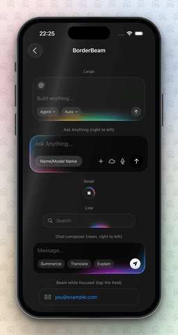

<p align="center">
  
</p>

<h1 align="center">BorderBeam</h1>

A beautifully animated border beam for SwiftUI — with Metal shader rendering and custom colors.

[](#)
[](./LICENSE)
[](#installation)
[](#contributing)

* * *

## ✨ Features

- 🧩 **Wrap anything**: text fields, menus, pickers, buttons or plain views
- ⚡ **One GPU pass**: beam and glow drawn by a Metal shader, no blur layers, no per-frame gradient rebuilds
- 🔷 **Any shape**: rounded rectangle, capsule or circle, with seam-free glow on every one
- 🎨 **Your colors**: any `[Color]`, a single color, or ready-made palettes
- 🔀 **Direction, intensity, timing and speed** as parameters
- 🎯 **State-driven**: drive `active` from anything (focus, loading, hover) with a smooth fade
- 🌓 **Dark and light surfaces**
- ♿ **Reduce Motion aware**: shows a still beam

* * *

## Installation

**Swift Package Manager**: Xcode → *File → Add Package Dependencies…* and enter
`https://github.com/ismnoiet/border-beam-ios`, or in `Package.swift`:

```swift
.package(url: "https://github.com/ismnoiet/border-beam-ios", from: "1.0.0")
```

then add the `BorderBeam` product to your target and `import BorderBeam`.

**CocoaPods** (experimental)

```ruby
pod 'BorderBeam', '~> 1.0'
```

### Requirements

| Platform | Minimum |
|---|---|
| iOS | 17.0 |
| macOS | 14.0 |
| visionOS | 1.0 |
| Swift / Xcode | 5.9 / 15 |

* * *

## Quick start

```swift
import BorderBeam

struct ContentView: View {
    @State private var text = ""

    var body: some View {
        BorderBeam(shape: .rounded(26), colors: BeamPalette.spectrum) {
            TextField("Build anything...", text: $text)
                .padding()
                .frame(width: 320)
        }
    }
}
```

Other shapes and styles:

```swift
BorderBeam(.small, shape: .circle) { Image(systemName: "stop.fill").padding(12) }
BorderBeam(.line, shape: .capsule) { SearchField() }              // sweeps along the bottom edge
BorderBeam(direction: .rightToLeft, intensity: 0.75) { ... }
BorderBeam(colors: BeamPalette.single(.cyan)) { ... }             // one color
```

Only the beam, on a view you style yourself:

```swift
myView.borderBeam(shape: .rounded(12))
```

* * *

## Props

`BorderBeam` (container) and `.borderBeam(...)` (modifier) share these:

| Prop | Type | Default | Description |
|---|---|---|---|
| `style` | `BeamStyle` | `.large` | `.large` (comet + soft glow), `.small` (tight ring), `.line` (sweeps along the bottom edge) |
| `shape` | `BeamShape` | `.rounded(26)` | `.rounded(r)`, `.capsule`, `.circle` |
| `direction` | `BeamDirection` | `.leftToRight` | `.leftToRight` (clockwise) or `.rightToLeft` (counter-clockwise), judged along the top edge |
| `active` | `Bool` | `true` | Fades the beam in/out, then pauses the timeline so idle beams cost nothing |
| `colors` | `[Color]` | `BeamPalette.colorful` | First color is the tail, last is the head |
| `intensity` | `Double` | `1` | Overall brightness, 0 to 1 |
| `timing` | `BeamTiming` | `.default` | Lap, sweep and fade durations |
| `surface` | `Color?` | `Color(white: 0.11)` | Container only. Background fill, `nil` for none |
| `borderColor` | `Color` | `white 8%` | Container only. Hairline border |
| `content` | `@ViewBuilder` | n/a | Container only. Anything you like |

* * *

## Colors and palettes

Pass any `[Color]`. Ready-made palettes:

| Palette | Look |
|---|---|
| `BeamPalette.colorful` | Green, blue, purple, pink, orange (default) |
| `BeamPalette.gemini` | Blue, purple, red, orange, yellow, green |
| `BeamPalette.spectrum` | Blue, teal, cyan, green, yellow, orange, red |
| `BeamPalette.neon` | Cyan, blue, violet, magenta |
| `BeamPalette.sunset` | Gold, orange, coral, purple |
| `BeamPalette.aurora` | Mint, sky, indigo, lilac |
| `BeamPalette.silver` | Cool, subtle white-blue |
| `BeamPalette.mono` | White |
| `BeamPalette.single(_:)` | One color, fading in and out along its length |

```swift
BorderBeam(colors: BeamPalette.single(Color(red: 0.25, green: 0.85, blue: 0.5))) { ... }
```

* * *

## Direction

```swift
BorderBeam(direction: .leftToRight) { ... }   // default, clockwise
BorderBeam(direction: .rightToLeft) { ... }   // counter-clockwise
```

* * *

## Timing and speed

```swift
BorderBeam(timing: BeamTiming(rotateDuration: 4.5)) { ... }   // slow lap

VStack { ... }.beamSpeed(1.5)   // speed for every beam inside (1 = normal)
```

| `BeamTiming` field | Default | Description |
|---|---|---|
| `rotateDuration` | `2.4` | Seconds for one full lap (`.large`, `.small`) |
| `lineDuration` | `2.0` | Seconds for one there-and-back sweep (`.line`) |
| `fade` | `0.6` | Fade in/out when `active` changes |

> `.beamSpeed(_:)` can change while a beam is running; it speeds up or slows down smoothly without jumping.

* * *

## Any content, any state

Controls inside the beam behave normally. Drive `active` from any state, for example focus:

```swift
struct FocusField: View {
    @State private var email = ""
    @FocusState private var focused: Bool

    var body: some View {
        BorderBeam(shape: .rounded(16), active: focused, colors: BeamPalette.aurora) {
            TextField("you@example.com", text: $email)
                .focused($focused)
                .padding()
        }
    }
}
```

* * *

## Example app

Open `Package.swift` in Xcode, choose the `BorderBeamDemo` scheme and use the preview, or show `BorderBeamExamples()` from an app.

| Demo | Shows |
|---|---|
| Large, Ask Anything | Prompt cards, spectrum palette, right to left |
| Small | Round stop button |
| Line | Search bar |
| Chat composer | Neon palette, right to left |
| Beam while focused | `active` driven by focus |
| Pricing card | Sunset palette |
| Now playing | Slow silver beam |
| Toast | Single color, fast lap |
| Avatar + gradient button | Small style on circle and capsule |
| Single color | Blue, green, white |

Source: [`Sources/BorderBeamDemo/Examples.swift`](./Sources/BorderBeamDemo/Examples.swift)

* * *

## How it works

Each beam is a single SwiftUI `colorEffect` backed by a Metal shader. The crisp edge is measured along the border itself, and the soft glow is a chain of Gaussian blobs laid along the beam's path, so it needs no blur layers and can't produce seams on any shape. The beam's position is accumulated frame by frame, which is why the speed can change at any time without a jump. The timeline pauses when the beam is inactive, and Reduce Motion shows a still beam.

* * *

## ⭐ Support

If you find this useful, give the repo a star.

## Contributing

Issues and PRs are welcome.

## License

MIT © [ismnoiet](https://github.com/ismnoiet)
